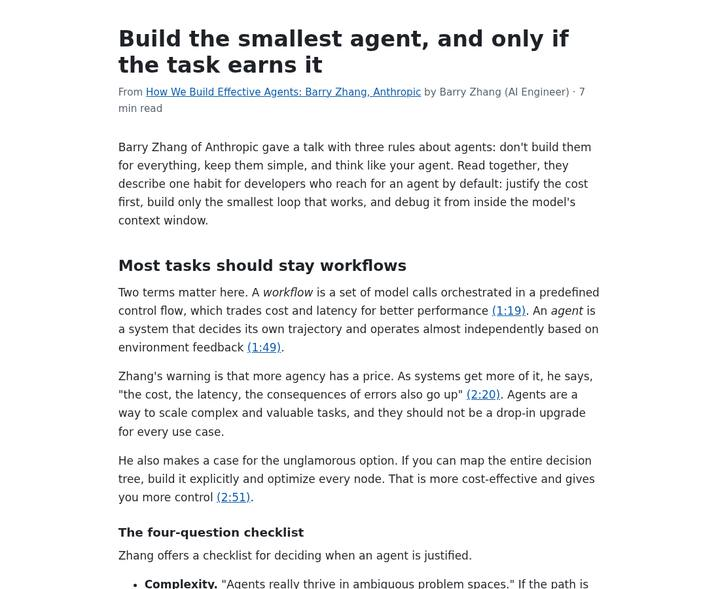
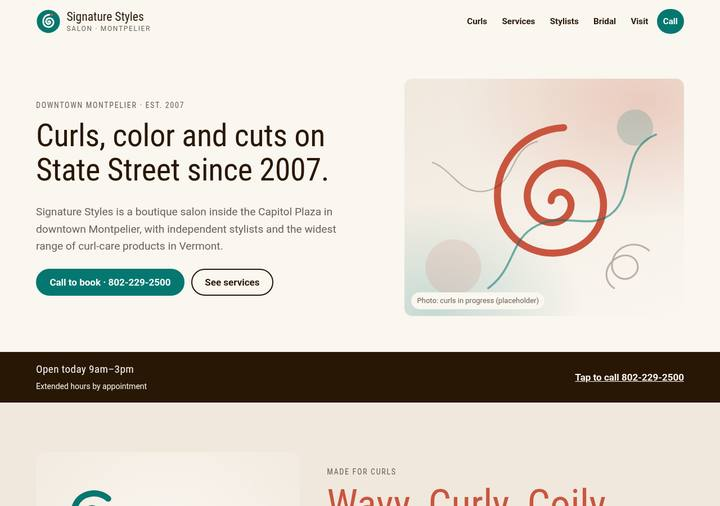

# Demo flows: three end-to-end graph flows and what they needed

Three flows were built to find the limits of lane playbooks, graph routes and the agent sandbox, and what was added to make them work. Each lives under `demo/<flow>/` as a manifest plus Markdown documents, and `scripts/demo-flows.mjs` installs them into a running Frameboard over its HTTP API. The decisions they forced are [ADR 0010](../adr/0010-lane-runs-create-cards.md) (lane runs create cards) and [ADR 0011](../adr/0011-lane-actions-publish.md) (lane actions; publish).

## The flows

1. **Video to blog** (`demo/video-to-blog`): a YouTube link → transcript → outline → post with diagrams and code → review loop → publish to a site. Shows the transcript field, HTML previews and the publish action.
2. **Local business sites** (`demo/business-sites`): a list of businesses in a town → one card per business → research, owners, socials → a design brief in the owner's taste → an HTML mockup previewable in the app. Shows created cards and concurrent runs.
3. **Outlier remix** (`demo/outlier-remix`): a screenshot of an outlier video (big views, small channel) → packaging analysis → titles → intro → thumbnails from Codex (native image generation) and from Claude (SVG rendered with rsvg-convert) → a retention-built script. Shows provider-specific nodes and image outputs.

## Manifest format (`demo/<flow>/flow.json`)

```json
{
  "project": "Video to blog",
  "flow": { "name": "Main", "kind": "graph" },
  "templates": [ { "id": "blog-post", "name": "Blog post", "title": { "label": "Post title", "max": 500 }, "fields": [ … ], "imageRoles": [ … ] } ],
  "template": "blog-post",
  "map": "MAP.md",
  "skills": ["skills/voice.md"],
  "nodes": [
    { "name": "Inbox", "color": "lavender", "x": 0, "y": 40, "playbook": "lanes/inbox.md" },
    { "name": "Outline", "color": "blue", "x": 380, "y": 40, "playbook": "lanes/outline.md" }
  ],
  "cards": [
    { "node": "Inbox", "title": "…", "fields": { "originalVideoUrl": "https://…" }, "images": [ { "file": "assets/screenshot.png", "roles": ["original"] } ] }
  ]
}
```

- `templates` are full card template definitions (`public/card-template.js`); the installer creates each unless a template with that `id` exists. `template` is the flow's template for new cards.
- `nodes` are created in order; the first is the start node. A node may name the `template` of the cards it holds (for a lane that receives created cards of another template); `--check` reads its playbook against that template instead of the flow's, and the installer writes it into the playbook as its `template:` setting. Each `playbook` file is a lane playbook whose `lane:` line the installer sets to the created lane's ID. `routes:` and `creates.lane` name lanes **by name** so the files read naturally; the installer leaves them as names, which `resolveRoutes` and `resolveCreates` accept.
- `skills` and `map` are written as they are. `cards` are created after the nodes, each in its named node, with field values and gallery images uploaded from `assets/` (roles: `original`, `inspiration`, or any role key of the template; the first image is the display image).
- A card may also carry `"youtube": "<url field key>"`. The installer sends that field's value to `POST /api/youtube` with `transcript: true`, then fills the card: the title (if the manifest gives none), the template's `originalVideoTitle` field (if it has one and the card gives no value), the template's `transcript: true` field (the caption text, trimmed and cut to the field's limit; a video without captions only prints a note), and the video's thumbnail as the display image and the `original` image. Image `roles` take the template's role keys or labels, and `cover` (or `display`) picks the display image; the first image is the display image unless one lists `cover`.

### Running

```
node scripts/demo-flows.mjs [--base http://127.0.0.1:3000] [--only <flow-dir-name>] [--replace] [--check] [demo]
```

- `demo` is the folder holding the flow folders (default: `demo/` in the repository); every sub-folder with a `flow.json` is a flow, and `--only` (repeatable, or comma-separated) picks some by folder name. `--base` is the running Frameboard.
- Each flow is checked first (below); a flow with problems is reported and not installed, and the others still install. The exit code is 1 if any flow had a problem or failed, with the server's message, and 0 otherwise.
- The installer prints one line per step, in this order: templates (created unless one with that `id` exists), the project (`kind` from `flow.kind`, `template` as its card template; the flow is renamed when `flow.name` differs), the manifest's nodes in order with their colors and positions, then the project's starter nodes and their leftover playbooks are removed, then `MAP.md`, the skills and each node's playbook (written as `lanes/<file name>.md`, replacing the empty playbook a graph node starts with, with its `lane:` line set to the created node's ID and `routes:` and `creates:` left as names), then the cards (images uploaded from `assets/`, then created in their node). Last it reads the flow back and reports any playbook error or route that leads nowhere.
- A project with the same name is left alone and reported as skipped. `--replace` deletes it first (unarchiving it if needed), so its cards and chats go too; the playbook folder stays on disk, as for any deleted flow. Templates are never replaced or deleted.
- `--check` needs no server. For each flow it verifies that: `flow.json` is valid; every template passes `validateTemplate` and has a unique `id`, and `template` names one of them or the built-in `youtube-video`; each node has a unique name, a lane color and numeric `x` and `y`; every file named in `map`, `skills`, a node's `playbook` and a card image exists inside the flow folder; every playbook parses with `playbookSettings` against the flow's template (settings errors are problems, unknown settings are warnings) and accepts the installer's `lane:` patch; every `routes:` target and every `creates.lane` names a node, and `creates.template` names a manifest template or `youtube-video`; every `skills:` entry has a file in `skills`; and every card names an existing node and template, only sets fields of that template (within their limits), gives images with supported file types and known roles, and names a `youtube` field that is a url field holding a value. It prints one line per flow plus a list of problems, and exits 1 when there are any.

## What was missing, and what was done

Each flow was designed against the app as it stood, run live with the installed Claude Code (Claude Max) and Codex, and the gaps below were closed in the same branch. The order is the order they were hit.

1. **A lane could not create cards.** The business flow starts with one list and needs one card per business. Lane playbooks gained `creates:` and lane results `"cards"` ([ADR 0010](../adr/0010-lane-runs-create-cards.md)); created cards record their origin (`parentId`), take the lane's `set:` values and get an on-entry run, the one exception to "creating a card never starts an agent". The editor shows **Created from** and **Created N cards** chips.
2. **Nothing could publish.** The agent boundary (ADR 0004) allows public HTTP(S) only, so an agent can never rsync or ssh. Publishing became a **lane action** ([ADR 0011](../adr/0011-lane-actions-publish.md)): `action: publish` copies the card's saved outputs to `data/sites/<site>/<slug>/` (served at `/sites/`) or runs `rsync` to `user@host:/path` on this computer with the user's own keys, records the exact command and outcome, and follows the lane's first route with `advance: auto`. It reuses lane runs end to end (requested on entry, cancelled if the card leaves, shown on the card), and waits for the previous lane's saves to finish.
3. **No transcript.** The YouTube lookup fetched a title and thumbnail only. A card template may now mark one text area `transcript: true`; the lookup fills it through the installed `yt-dlp` (manual captions before automatic, the video's own language before translations). Frameboard still never transcribes audio.
4. **HTML outputs were unreadable.** Saved outputs previewed only as images or plain text. `.html` (and `.svg`) now render as sandboxed pages (`previewPolicy` in `public/library-format.js`: opaque origin, inline styles and scripts, no fetch, no forms), with an in-app **Preview** dialog in the chat and a **Saved** row on the card's playbook panel.
5. **Board summaries read every playbook against the flow's template.** Lanes holding created cards of another template showed false errors and a disabled Run playbook. A lane playbook may now say `template: <id or name>`; the board, route editing and conversions read its settings against that template, while a run always reads them against the card's own.
6. **Only localhost could open the board.** `FRAMEBOARD_HOSTS` lists the host names a local reverse proxy (`tailscale serve`) forwards; the origin check follows `X-Forwarded-Proto`.
7. **Headless Chromium does not run inside the sandbox** (its singleton socket is a pathname UNIX socket the seccomp filter refuses). Rendering goes through `rsvg-convert`, Inkscape or Pillow instead, which the thumbnail and post skills document. This is a documented limit, not a change.
8. **Codex is held on a fresh data directory** until the user chooses **Use my full Codex setup (not isolated)** in Settings (ADR 0002), because this machine's Codex has inherited `AGENTS.md`, apps and plugins that Frameboard cannot isolate. The demo data directory has that choice saved; it is the user's call on any other.

## Live run: Video to blog (2026-10-17)

Sample card: "How We Build Effective Agents" (AI Engineer, 15:09, automatic English captions). The installer's lookup filled the transcript (14,424 characters). One click on **Run playbook** in Inbox, then every move was the agents' own:

| Node | Agent | Started | Result |
| --- | --- | --- | --- |
| Inbox | Claude Sonnet | 18:56 UTC | Re-fetched captions with timestamps, 29 paragraphs; routed `ready` |
| Outline | Claude Sonnet | 18:57 | Outline (5,969 characters); routed `outlined` |
| Draft | Claude Sonnet | 18:58 | 1,500-word post in `post`, `post/index.html` saved (two hand-drawn SVG diagrams, one code block, timestamped citations); proposed a new title; routed `drafted` |
| Review | Claude Opus, fresh context | 19:00 | Pass 1: five problems; routed `revise` |
| Draft (2nd pass) | Claude Sonnet | 19:00 | Fixed all five, saved `index.html` again; routed `drafted` |
| Review | Claude Opus | 19:02 | Pass 2: approved; routed `approved` |
| Publish | Frameboard | 19:03 | Published 1 file to `/sites/blog/ai-engineer-how-we-build-effective-agents-barry-zhang-anthro/`, put the address in Published URL, followed `published` |
| Published | — | 19:03 | End |

Seven minutes, nine automatic moves (under the twelve-move pause), a 20 KB self-contained page with no network requests. Two things the run surfaced: the Draft agent proposes a better **Post title** but cannot apply it (title is not in `may_edit`), so the slug comes from the card title the user accepted, and the Review agent said so in its notes; and a third revise pass would publish with `[open]` notes, which the playbook states.



## Live run: Local business sites (2026-10-17)

Sample card: "Montpelier, VT — four local businesses" (a bakery-café, a bookshop, a salon and an outfitter, with their websites). One click on **Run playbook** in Intake created four cards in Research, and each ran on its own, four Claude sessions at a time:

| Node | Agent | What came back |
| --- | --- | --- |
| Intake | Claude Sonnet | 4 created cards (title, location, website), list notes |
| Research | Claude Sonnet, WebSearch/WebFetch | 560–810 words of sourced research each; website confirmed; owners only as the business states them (two cards name co-owners, one names first names from the site, one left the field empty) |
| Socials | Claude Sonnet | Instagram, Facebook and other public profiles with follower counts and cadence; "not visible" where a logged-out visitor cannot see posts |
| Brief | Claude Opus, fresh context | 1,500–1,600-word design brief: positioning, three adjectives with evidence, palette, type, site map, page content, a web-app feature, copy angles |
| Mockup | Claude Opus, fresh context | One self-contained `site/index.html` (31–40 KB, inline CSS, inline SVG logo mark, no network requests), saved as an output and previewable in the app; mockup notes list what a real build needs |
| Review | user | All four cards arrived between 19:06 and 19:08 UTC, eight minutes after Intake |

The research skill kept the work to public business information and the agents said when they could not confirm something. Instagram cadence was often "not visible" because the agent browses logged out, which is the honest answer. The mockups are credible first drafts in the brief's palette; photos are placeholders by design.



## Live run: Outlier remix (2026-10-17)

Sample card: "Turn Claude Code Into Your AI Operating System (4 Layers)" (5,150 subscribers, 272,620 views, ratio 52.9×, 14:56, automatic captions), found with vidIQ's outlier search and checked with yt-dlp; the installer fetched its thumbnail and transcript. One click on **Run playbook** in Drop:

| Node | Agent | Started | Result |
| --- | --- | --- | --- |
| Drop | Claude Opus (vision) | 19:01 UTC | Channel stats and a 6,500-character packaging analysis: the title skeleton, the thumbnail's composition and planted question, the promise, the audience, what to keep and what to beat |
| Titles | Claude | 19:02 | 12 scored titles across patterns, top 3 and one recommended; none reuse the original wording |
| Intro | Claude | 19:02 | A 175-word seven-part hook with `[PROOF: …]` placeholders where the creator's own numbers go, plus three alternate first lines |
| Thumbnail · Codex | Codex gpt-6.1-sol, fresh context | 19:03 held, 19:04 | Held until **Use my full Codex setup** was saved in Settings, then three written concepts and two generated 1672×941 images in the chat, ready to adopt into the gallery |
| Thumbnail · Claude | Claude Opus, fresh context | 19:06 | Two 1280×720 PNGs rendered from hand-written SVG with `rsvg-convert`, saved as outputs with their SVG sources |
| Script | Claude Opus | 19:08 | A 2,700-word spoken script starting with the intro, chapter markers, `[B-ROLL]`/`[ON SCREEN]` cues, open loops and re-hooks per the retention skill |
| Review | user | 19:13 | End: pick the title, adopt a thumbnail, record |

Twelve minutes including the hold. The two providers' thumbnails make the comparison the flow was built for: Codex's photoreal composition against Claude's flat vector, both from the same concepts, neither a copy of the outlier's image.

 

## Limits that stand, and what would lift them

Found while running the three flows; none blocked a demo, each is a real edge of the system today.

- **One agent per card, and no join.** Fan-out works through created cards (four businesses ran at once), but nothing gathers created cards back into their origin card, and a lane run cannot read sibling cards. A "join" lane that runs when every created card reaches a node, with the siblings' fields in its prompt, is the next step.
- **Parallel attempts on one card are sequential.** The outlier flow asked Codex and Claude for thumbnails; they ran one after the other on the same card (each with fresh context), not side by side. Side-by-side needs either created cards per provider or a second active attempt per card, which the queue forbids on purpose.
- **Codex lane runs cannot use the network from shell commands.** Codex's own sandbox denies network to commands, and an approval request during a lane run has nobody to answer it, so the run would stall. Codex is used where its native tools suffice (image generation); Claude does the web research. A per-lane grant (`allow: network`) recorded as a conversation grant would lift this.
- **Codex holds on a new data directory** until the inherited-setup choice is saved in Settings (ADR 0002). The installer does not make that choice for the user.
- **Headless Chromium is unavailable in the sandbox**, so agents cannot screenshot their own pages. They render SVGs with `rsvg-convert` and read the HTML; a rendering service outside the boundary (like publishing) would give them a real screenshot.
- **Published pages are inline-only and flat.** `style-src`/`script-src` cannot be `'self'` inside the sandbox policy, so a page's separate `style.css` does not apply, and outputs land in one folder. The skills require one self-contained file; a site with assets needs the policy and layout extended.
- **Slugs come from card titles.** Two cards with the same title publish over each other, and a title the agent proposes is not the slug until the user accepts it.
- **Remote publishing is proven only as a command.** `rsync` to `user@host:/path` runs with this computer's keys and reports failure honestly; it was exercised with a fake rsync in tests, not against a live VPS (no key here). A target per site in Settings, with a connection check, would make it a one-click setup.
- **Transcripts are captions.** Videos without captions have no transcript, the app's fetch has no timestamps (the Inbox playbook re-fetches with them), and a long transcript must travel back through the result block to be edited.
- **A loop pauses after twelve automatic moves.** The blog flow used nine; a flow with two review loops would hit the pause and wait for the user, which is the intended safety.
- **The origin chip is not live.** "Created N cards" in the editor header is computed when the card opens; the playbook panel's row is live. A card-list change hook would fix it.
- **Model names are pinned in playbooks** (`model: sonnet`), so a flow exported to another machine depends on that machine's model list.

## Running the demo

```sh
PORT=3100 DATA_DIR=/path/to/demo-data FRAMEBOARD_HOSTS=<host>:8443 npm start
node scripts/demo-flows.mjs --base http://127.0.0.1:3100 --replace
```

Enable Claude (and, for Codex, **Use my full Codex setup** if this machine's Codex has inherited apps or plugins) in Settings and refresh models, then open each project and press **Run playbook** on the sample card: Inbox, Intake or Drop. Everything after that is routes.
